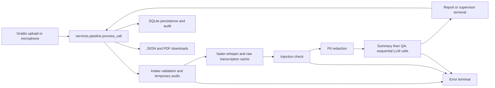

# Project 28 baseline — 2026-10-24

Scope: clone, inspect, configure and validate the existing application. No future
platform features, training, additional model/dataset downloads, commits or pushes
were performed during the initial preparation phase. Publication authorized later
is recorded at the end of this document. Findings below come from source inspection;
runtime evidence is identified separately.

## Clone verification

- Path: `C:\Users\omar\Projects\Adaptive-Call-Center-Intelligence`
- Source (now remote `upstream`): `https://github.com/ANI-IN/Call-Center-Intelligence-System`
- Project remote `origin`: `https://github.com/soubaibiomar/call-center-audio-analysis.git`
- Upstream branch: `main`; development branch: `feature/project28-foundation`.
- HEAD: `fed4b610742c1337147281fcec8f2cdcc0a79be5` (full-history clone).
- Initial working tree clean. Final changes are local setup/documentation only;
  original source, history and LICENSE preserved. See final verification below.
- `LICENSE` is MIT, copyright 2026 Animesh Kumar. CONTRIBUTING's CC BY-NC claim
  conflicts with that file; preserve the actual LICENSE and clarify upstream before
  redistributing sample audio. Sample README limits samples to education/testing.

## Actual repository layout and architecture

```text
app.py                         startup and Gradio launch
src/
  agents/                      intake.py, transcription.py, summarization.py,
                               qa_scoring.py, report.py
  graph/                       state.py, edges.py, workflow.py
  database/                    connection.py, models.py
  security/                    audit.py, injection_detector.py, pii_redactor.py
  services/                    pipeline.py, history.py, observability.py
  ui/                          app_builder.py
    tabs/                      analyze.py, history.py, observability.py
  utils/                       audio.py, config.py, formatters.py, llm_factory.py
tests/                         conftest.py; unit/, security/, integration/
data/samples/                  ten tracked MP3s, README (~30 MiB)
docs/                          architecture.md, getting-started.md
.github/                       CI, issue and PR templates
Dockerfile                     Python 3.12 slim, ffmpeg, non-root UID 1000
pyproject.toml, requirements.txt, Makefile, .pre-commit-config.yaml
.env.example, .gitignore, .editorconfig
README.md, CONTRIBUTING.md, SECURITY.md, CHANGELOG.md, CODE_OF_CONDUCT.md, LICENSE
```

Package `__init__.py` files provide namespaces. There is no separate backend API,
frontend project, Compose file, migration framework, queue or training subsystem.

`app.py` loads configuration, creates SQLite tables, eagerly loads Whisper, compiles
the graph and builds the UI. Importing it has these startup side effects.



## Implemented inventory versus target

| Capability | Actual implementation | Target gap |
|---|---|---|
| Audio intake | WAV/MP3/FLAC/M4A signatures, 50 MiB and 60-minute limits; mutagen metadata; temp files | Streaming, durable objects, lifecycle policy, explicit preprocessing |
| ASR | faster-whisper/CTranslate2, configured model (`tiny` default), VAD, timestamps, greedy decoding, artifact cleanup | `language="en"` hard-coded; no French/Arabic/Darija evaluation or Qwen3-ASR adapter |
| Confidence | Heuristic 70% transformed log probability + 30% speech probability; review fields | No calibrated uncertainty, reference transcripts, WER/CER or regression corpus |
| Speaker labels | Agent/Customer regex, gaps >1.2s, questions and short answers | No voice embeddings, overlap handling or pyannote neural diarization |
| Understanding | Structured summary: purpose, discussion, actions/owners/deadlines, resolution, text sentiment and entities | No separate intent taxonomy, acoustic emotion, RAG or live assistance |
| QA/compliance | LLM rubric: professionalism 15%, empathy 20%, resolution 30%, compliance 20%, clarity 15%; recomputed weighted score, severity flags | No company policy retrieval, calibrated human labels or governed coaching |
| Orchestration | LangGraph typed state and conditional routes; sequential summary then QA; retry backoff | No checkpointing, durable jobs, streaming or human approval workflow |
| Providers | OpenAI `gpt-4o`, Gemini `gemini-2.0-flash`, Groq `llama-3.3-70b-versatile` identifiers in code | No Ollama/Qwen local endpoint; current remote model availability not validated |
| Security | Regex PII and injection checks, metadata PII detection, audit inserts, non-root container | No auth/RBAC, enforced encryption, retention controls or comprehensive multilingual PII |
| Persistence | SQLAlchemy + sqlite3; CallRecord, AuditLogEntry, TranscriptionCache | No PostgreSQL, schema migrations, dataset/model versioning or object storage |
| UI/reporting | Three Gradio tabs: Analyze, History (latest 200), Observability; transcript, summary, QA, JSON/PDF exports | No React/Vite/TypeScript client or WebSocket API |
| Monitoring | DB aggregate counts/scores, recent audit events and optional LangSmith decorators | No service health metrics, durable failure accounting or model drift monitoring |
| Learning | None | Corrections, active learning, validation/versioning, PyTorch, MLflow, registry, independent evaluation and rollback all future work |

## Dependency and configuration inventory

Python metadata allows >=3.11; upstream CI tests 3.11/3.12 and Docker uses 3.12.
Use 3.12 for this baseline rather than the host's 3.14. No Conda required.

Direct pins (identical in requirements and project metadata): LangGraph 0.4.1,
LangChain 0.3.25, langchain-openai 0.3.12, LangSmith 0.3.42, OpenAI 1.82.0,
Gradio 5.29.0, faster-whisper 1.2.1, Pydantic 2.11.3, SQLAlchemy 2.0.41,
python-dotenv 1.1.0, ReportLab 4.4.0, soundfile 0.13.1, mutagen 1.47.0,
langchain-google-genai 2.1.4 and langchain-groq 0.3.2.
Dev pins: pytest 8.3.5, pytest-asyncio 0.25.3, Ruff 0.11.8, mypy 1.15.0,
detect-secrets 1.5.0 and pre-commit 4.2.0. Transitives include PyAV, NumPy,
ONNX Runtime, tokenizers and CTranslate2. PyTorch is **not** declared, despite
being imported optionally for device detection. No upstream lockfile exists.

| Variables | Actual behavior |
|---|---|
| `LLM_PROVIDER`, `OPENAI_API_KEY` | Default openai; missing OpenAI key stops config loading. Invalid provider falls through to OpenAI client. |
| `GOOGLE_API_KEY`, `GROQ_API_KEY` | Read by provider libraries; needed for their respective cloud clients. |
| `LANGCHAIN_API_KEY`, `LANGCHAIN_PROJECT`, `LANGCHAIN_TRACING_V2` | Optional tracing; keep disabled during preparation. |
| `DB_PATH`, `DB_ENCRYPTION_KEY` | SQLite location and optional PRAGMA; standard sqlite3 does not implement SQLCipher encryption. |
| `MAX_COST_PER_CALL_USD` | Parsed but never enforced. |
| `MAX_RETRIES_PER_NODE`, `LLM_TIMEOUT_SECONDS` | Summary/QA retry count and client timeout; client construction lies outside retry handlers. |
| `WHISPER_MODEL_SIZE` | tiny default in config; model is downloaded at startup if uncached. |
| `CONFIDENCE_THRESHOLD`, `LOW_CONFIDENCE_HALT_RATIO` | Code defaults 0.3/0.8, upstream example 0.6/0.4; neither halts workflow. |
| `SPACE_ID`, `GRADIO_SERVER_NAME`, `GRADIO_SERVER_PORT` | Entrypoint hard-codes port 7860 and host based on SPACE_ID, overriding the Docker Gradio env defaults. |

Safe `.env.project28.example` and ignored local `.env` contain no credentials,
preserve provider/model defaults and disable tracing/analytics. Empty provider key
intentionally fails closed. Do not copy upstream placeholder keys into production.

## Risks confirmed by source inspection

1. Raw transcript is cached before redaction; traceable nodes receive raw audio/text
   before the PII node. Metadata is detected, not actually redacted; caller/dept are
   logged. Regex covers mostly US phone/SSN/card/email formats, not names/addresses
   or comprehensive Moroccan/Arabic PII. Use synthetic data for preparation.
2. Standard SQLite silently ignores the SQLCipher-style PRAGMA. The interpolated
   key is not validated. A configured DB key is not evidence of encryption.
3. `route_after_transcription` ignores low-confidence review flags. Injection status
   becomes failed at `error_node`; supervisor state is flagged but `compile_report`
   always sets report status completed. DB metrics therefore misrepresent review
   and failures (failures generate audit entries, not CallRecord rows).
4. Transcription cache key hashes only audio bytes, not model/language/settings;
   stale results can survive model changes. Cache exceptions are silently swallowed.
5. Windows temporary-file handling in pipeline/history reopens still-open
   NamedTemporaryFile handles; export/microphone failures are possible. Audio cleanup
   checks `/tmp/`, which misses Windows paths; history exports have no cleanup.
6. Docker binds 127.0.0.1 inside the container without SPACE_ID despite its env
   defaults. No CUDA/cuDNN runtime or GPU declaration; normal dependencies select CPU
   because torch is absent. CTranslate2 GPU readiness is not proven by nvidia-smi.
7. PDF Paragraph receives unescaped model text; Unicode/Arabic shaping is not
   provided. Model client/configuration exceptions can bypass typed retry errors.
8. CI excludes integration tests, skips format checks and makes dependency audit
   advisory. Existing tests mostly mock model/LLM execution and do not prove audio
   accuracy, real provider compatibility or secure deployment.

## Incremental migration assessment

P0 = stabilize baseline first; P1 = first ASR learning milestone; P2 = platform
boundaries; P3 = later intelligence. Entries cover all existing production modules;
package initializers remain unchanged until a package boundary actually moves.

| Module(s) | Decision and reason / expected improvement | Dependencies, risk and priority |
|---|---|---|
| `app.py` | Modify startup/config lifecycle; keep Gradio runnable during migration | config, DB, graph, UI, ASR; eager downloads and container bind; P0 |
| `utils/config.py` | Extend validated provider/model/device config; enforce explicit policies | all runtime modules; default drift/secret handling; P0 |
| `utils/llm_factory.py` | Extend with explicit local Qwen/Ollama adapter later; retain cloud choices | summary/QA; structured output and timeouts differ; P2 |
| `utils/audio.py` | Keep validation, extend preprocessing/segmentation boundary | intake, state; corrupt inputs and resource limits; P1 |
| `utils/formatters.py` | Keep presentation helpers, decouple from future API payloads | state, UI/services; Unicode/untrusted output; P2 |
| `agents/intake.py` | Modify to managed audio references and deterministic cleanup | audio/state, future object store; PII retention and temporary paths; P0 then P2 |
| `agents/transcription.py` | Keep Whisper adapter; extract cache, speaker and confidence seams; add ASR benchmark later | intake/state/DB; English lock, stale cache, GPU contention; P1 |
| `agents/summarization.py` | Keep schema/prompts; extend grounded intent/RAG behind provider interface | transcript/state/LLM; hallucination and injection; P3 |
| `agents/qa_scoring.py` | Keep weighted scoring; extend versioned policy/evaluation and coaching | summary/transcript/LLM; speaker errors bias scores; P3 |
| `agents/report.py` | Modify status propagation, safe Unicode export and persistence boundary | state/DB/ReportLab; history compatibility and data loss; P0 then P2 |
| `graph/state.py` | Extend versioned DTOs for provenance, model/dataset versions and review decisions | every agent/service; stored JSON backward compatibility; P1 |
| `graph/edges.py` | Modify review/failure semantics before adding adaptive branches | state/workflow; dropped uncertainty and misleading status; P0 |
| `graph/workflow.py` | Keep orchestration; fix status semantics, later introduce durable job/checkpoint seams | agents/security/config; retries/idempotency and raw traces; P0 then P2 |
| `database/connection.py` | Modify storage/security contract; later introduce PostgreSQL sessions and migrations | models/services; SQLite PRAGMA is not encryption, migration rollback; P0 then P2 |
| `database/models.py` | Extend versioned schema while retaining/importing historical records | report/cache/audit/history; duplicated JSON and cache invalidation; P1/P2 |
| `security/pii_redactor.py` | Extend multilingual policy with evaluated recall/precision | workflow/cache/export/audit; false negatives and excessive redaction; P0/P1 |
| `security/injection_detector.py` | Keep as one layer; extend normalized checks and scoped LLM inputs | workflow/LLM; bypasses and false positives; P2 |
| `security/audit.py` | Extend structured sanitized identity-aware audit events | DB and future auth; missing identity and PII in details; P0/P2 |
| `services/pipeline.py` | Modify Windows files/status/error handling; extract reusable use case for future API/workers | graph/report/audit; concurrency/idempotency and swallowed persistence errors; P0/P2 |
| `services/history.py` | Keep read-service behavior; add pagination and access scoping later | DB/state/formatters; historical JSON compatibility; P2 |
| `services/observability.py` | Keep aggregates; extend accurate lifecycle/model metrics | DB/audit/config; failed/flagged undercount; P0/P2 |
| `ui/app_builder.py` | Keep as baseline acceptance UI; gradually replace with API-backed React client | all tabs/services; avoid losing existing workflows; P2 |
| `ui/tabs/analyze.py` | Keep upload/results; extend correction workflow only after ASR evaluation contract | pipeline; long synchronous callbacks and PII display; P1/P2 |
| `ui/tabs/history.py` | Keep history/download UX; modify file lifecycle, later versioned review views | history/report; Windows handles and missing cleanup; P0/P2 |
| `ui/tabs/observability.py` | Keep dashboard; later consume service metrics through API | observability service; stale/inaccurate counts; P2 |
| Dockerfile, manifests, CI, tests | Keep supported pins initially; lock dependencies and verify Linux/Windows separately | entire app; supply chain drift and GPU wheel compatibility; P0 |

Proposed boundaries: retain typed domain results and LangGraph use cases; put ASR,
speaker assignment, acoustic emotion, LLM/RAG, storage and learning behind independent
adapters. FastAPI/React become clients of these use cases; Dramatiq/Redis owns durable
jobs, PostgreSQL metadata and S3 audio objects. Each neural adapter has its own dataset,
evaluation, registry version and deployment policy, rather than a shared retraining loop.

Preserve existing endpoints/UI, schemas and history readers until replacement contract
checks pass. Use additive schema migrations, legacy JSON readers and explicit backfills;
switch adapters behind configuration with reversible model/application versions.

Recommended first development task: establish an immutable, consented multilingual
ASR evaluation set and model/config-aware inference adapter with WER/CER and latency/
memory measurements. Then complete one bounded correction -> dataset validation and
version -> fine-tune -> independent held-out evaluation -> approval -> registry ->
deployment/rollback cycle. Require measured improvement per language and no regression
before promotion. Other neural systems adapt independently later. No implementation
of that roadmap belongs in this baseline task.

## Environment and execution evidence

Host validation: Git 2.55.0.windows.3; uv 0.12.23; host Python 3.14.6; Node
24.18.0; Docker Compose 5.6.0. Docker initially reported Engine 29.9.1/Desktop
4.96.0, then briefly lost its Linux pipe during the first build attempt; it
subsequently recovered reporting Engine 29.9.2. No daemon restart was initiated.
Only n8n was running in the container inventory. Existing containers, Ollama images,
volumes and models were not modified. VS Code's `code` command, standard install
paths, Start Apps entry and exact WinGet package lookup were absent; opening VS Code
was therefore unavailable. No IDE installation was attempted.

GPU: RTX 4060 Laptop GPU, 8188 MiB, NVIDIA driver 610.88. Both host `nvidia-smi`
and an ephemeral container using the already-cached CUDA image succeeded:

```powershell
docker run --rm --pull=never --gpus all nvidia/cuda:12.9.0-base-ubuntu22.04 nvidia-smi --query-gpu=name,memory.total,driver_version --format=csv,noheader
```

CTranslate2 detected one CUDA device locally. `_detect_device()` nevertheless
returned `('cpu', 'int8')`: torch is absent from the declared dependency set.
This validates driver passthrough, not GPU inference or CUDA/cuDNN completeness.
No torch/CUDA packages or AI models were installed to change that behavior.

Created `.venv` through uv with CPython 3.12.15 (21 MiB interpreter download),
then installed the project and dev extras: 127 packages (~646 MiB in `.venv`). No dependency pins or
production source files were changed. `PROJECT28_REQUIREMENTS.lock.txt` records
the exact installed Windows package versions, with a relative editable project
reference. It is a Windows snapshot, not a hash-verified cross-platform lock;
Docker continues to use upstream requirements, so Linux transitives may differ.

| Command/check | Result |
|---|---|
| `uv venv --python 3.12 .venv` | Exit 0 |
| `uv pip install --python .venv/Scripts/python.exe -e '.[dev]'` | Exit 0; 127 packages installed |
| `uv pip check --python .venv/Scripts/python.exe` | Exit 0; dependencies compatible |
| `.venv/Scripts/python.exe -m pytest tests/ -q --tb=short` | Exit 0; **113 passed in 13.00s**; pytest-asyncio warns about unset future fixture loop default |
| `.venv/Scripts/python.exe -m ruff check --extend-ignore UP038 src/ tests/ app.py` | Exit 0; matches CI's existing rule exception |
| `.venv/Scripts/python.exe -m compileall -q app.py src/` | Exit 0 |
| `.venv/Scripts/python.exe -m ruff format --check src/ tests/ app.py` | Exit 1; pre-existing differences in services/history.py, services/pipeline.py and tests/unit/test_history_service.py |
| `.venv/Scripts/python.exe -m mypy src/` | Exit 1; missing ReportLab/faster-whisper stubs, missing optional torch, and installed NumPy stub uses Python 3.12 syntax while mypy config targets 3.11; checking aborted after 6 errors |
| Offline normal startup: `HF_HUB_OFFLINE=1`, then `.venv/Scripts/python.exe app.py` | Exit 1; `Required environment variable OPENAI_API_KEY is not set`; no model download or provider call |
| UI-only smoke harness | Exit 0; real build_app, compiled workflow and temporary SQLite DB; `/` and `/config` HTTP 200 on 127.0.0.1:17860; server closed and DB disposed |
| Bundled MP3 via soundfile | sample_01.mp3 read successfully: 48 kHz stereo, ~122.7 s; ffmpeg executable absent on host |
| SQLite encryption probe | sqlite3 accepted test PRAGMA but cipher_version returned no rows; persisted header remained `SQLite format 3`; confirms encryption is absent |

The UI harness constructed Config with empty keys and existing openai/tiny settings
directly, then called `build_app(config, compile_workflow(config, engine), engine,
AuditLogger(engine=engine))`. It deliberately bypassed `load_config` and Whisper
preload. No agents were mocked for this harness, but it did **not** execute inference
or analysis. The existing integration happy-path test mocks both Whisper and LLMs;
the persistence integration tests use temporary real SQLite. Contrary to upstream
onboarding text, all four existing integration tests run without a provider key.

Setup additions: `.dockerignore` excludes credentials, virtualenv, caches and local
databases from build context; `.env.project28.example` plus ignored `.env`; this
baseline; Windows package snapshot. No credentials were read into logs or invented.

### Reproduce local setup

Run in the verified project folder:

```powershell
uv venv --python 3.12 .venv
uv pip install --python .venv/Scripts/python.exe -r PROJECT28_REQUIREMENTS.lock.txt
# For a fresh checkout only; never overwrite an existing .env:
if (-not (Test-Path .env)) { Copy-Item .env.project28.example .env }
.venv/Scripts/python.exe -m pytest tests/ -q --tb=short
$env:HF_HUB_OFFLINE = '1'
.venv/Scripts/python.exe app.py
```

To enable actual analysis later, supply one real provider credential privately in
`.env`. OpenAI requires OPENAI_API_KEY; choosing Gemini/Groq explicitly requires its
own key. The factory reads keys from the environment rather than Config arguments.
Whisper weights are fetched from Hugging Face on first startup unless cached; no HF
token is explicitly required by application code. Keep offline mode until model
download/storage is planned, then remove it only for an intentional download.
Default tiny uses CPU int8 with current dependencies; larger models and concurrent
local LLMs require separate RAM/VRAM and disk budgets. No model download, real ASR
benchmark, paid API call, training, or end-to-end live analysis was attempted.

### Docker and final verification

- `docker build -t project28-foundation:baseline .`: retry succeeded, exit 0.
  Image ID `sha256:fa8bb8526ac809f36277753c9b704243583738f068ddfd736fc8c49799da6211`,
  reported size 2,648,872,511 bytes (~2.47 GiB); configured user `appuser`.
  No AI weights are bundled. The existing ffmpeg/build toolchain accounts for much
  of the image size. No Compose configuration was added.
- Container validation: Python 3.12.15, Gradio 5.29.0, ffmpeg 7.1.5;
  `python -m pip check` returned 0 with no broken requirements.
- `docker run --rm --pull=never --env-file .env -e HF_HUB_OFFLINE=1 project28-foundation:baseline`:
  exit 1, same missing OPENAI_API_KEY error as native startup. No download occurred.
- The same UI-only harness piped into `docker run -i --rm ... python -` passed,
  exit 0; `/` and `/config` returned HTTP 200 inside the container. It did not
  expose a host port, preload Whisper, validate credentials or run inference.
  The entrypoint host/port issue described above remains an unmodified source
  finding; this internal HTTP smoke does not establish host port reachability.
- All temporary smoke servers/containers were closed/removed. The built image and
  Docker build cache remain available. GPU probe used an existing cached image.
- At the end of initial preparation, branch and HEAD matched clone verification. `git diff --exit-code HEAD --
  app.py src tests requirements.txt pyproject.toml Dockerfile LICENSE` returned 0:
  original application, tests, dependency manifests, Dockerfile and license unchanged.
  `git diff --check` passed. Four untracked additions remain: `.dockerignore`,
  `.env.project28.example`, `PROJECT28_BASELINE.md`, `PROJECT28_REQUIREMENTS.lock.txt`.
  `.env` and `.venv` are ignored (verified with `git check-ignore`). Nothing staged,
  committed or pushed.

Preparation is complete with explicit runtime limits: actual audio analysis still
requires a real provider credential and an intentional Whisper model setup. Baseline
tests/UI startup work; GPU inference, remote model availability, production security,
Windows export behavior and end-to-end live analysis remain unverified. Address the
P0 compatibility/privacy/status items before using real customer recordings; then
begin the measurable ASR adapter/evaluation task described above.

## Authorized project publication

The user subsequently authorized committing and pushing this foundation to
`soubaibiomar/call-center-audio-analysis`. Its existing `main` contained the initial
MIT license commit `d806618ea42bc5e0f8d1d7818608c81df6c1aeec`.

The publication integrates that commit with the complete upstream history, without
rewriting either history. The only license resolution adds the existing project
copyright notice alongside the original Animesh Kumar notice; the upstream MIT
permission and disclaimer text remain intact. Application source and behavior are
unchanged. `origin` is the user's repository and `upstream` retains the source URL.

The repository import, safe configuration, dependency snapshot and validated baseline
form one cohesive bootstrap commit, with a Conventional Commit subject and a body
describing provenance, scope and verification. It is published to `main` and
`feature/project28-foundation` using ordinary non-force updates. Local `.env`, virtual
environment, databases, Docker image/cache and personal Codex instructions are excluded.

Commit preference: commit at complete, reviewed and validated engineering milestones;
avoid tiny per-edit or minute-by-minute commits. Do not manufacture timestamps or
delays. Future changes should follow the same rule.
