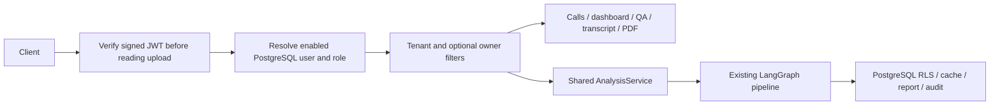

# STEP_09 API boundary decision

Decision date: 2026-10-25. Keep the modular monolith and the shared AnalysisService.
The FastAPI factory exposes versioned, typed integrations; Gradio remains a
trusted local compatibility interface. No Redis/Dramatiq worker is claimed here.

External issuer/audience/key configuration is required for protected access. The
current user has no IdP, so default access remains fail-closed. Tests use ephemeral
RSA identities with actual restricted PostgreSQL sessions. An issuer is not a
user account: operator-owned identity mappings connect signed subject and tenant
to an enabled local user. Authorization roles come from the database on each
request. No public account creation, local password login or auth bypass exists.

Explicit tenant filters and database row policies reinforce one another. A
ContextVar carries verified tenant/user into shared graph transactions without
changing the legacy tenant for Gradio. It resets on exception. API persistence
failure is an HTTP failure; Gradio retains its historical best-effort behavior.
API reports remove internal audio paths/trace IDs; downloads authorize before
rendering. PDF treats generated text as text rather than ReportLab markup.

Synchronous analysis returns 201 only after a report is produced and persisted.
A process-local semaphore permits one analysis at a time. STEP_10 must design
durable submission/idempotency/retries and propagate verified ownership into the
worker; ContextVar state does not travel through a broker. Job reads expose actual
persisted state with unmeasured progress null. Training remains separate.

Deployment remains loopback only. A real IdP integration test, public ingress/rate
limits, deployment policy, consent and inherited raw provider logging/tracing
remain open work. The legacy Gradio listener must not be exposed as an alternate
route around the API. CI PostgreSQL trust authentication is confined to a
disposable runner service with synthetic data; local application credentials and
restricted runtime roles remain unchanged.
