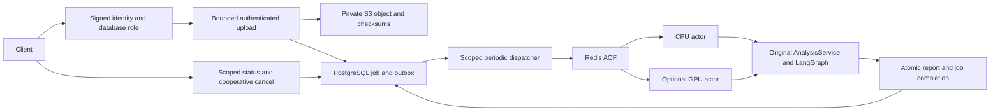

# Durable jobs decision — STEP_10

2026-10-26. Retain the modular monolith and original synchronous interfaces.
Add PostgreSQL job authority, Redis/Dramatiq delivery and private S3 audio storage.
Do not add Kubernetes, a training service or a second inference implementation.

Idempotency is per tenant/owner/request key and compares the content/metadata
fingerprint. Admission uses a short tenant advisory transaction lock; execution
holds a separate session lock per job. Dead processes release execution locks.
The durable row permits republishing after broker failure, so delivery is not
exactly once. Deterministic result identity and one completion transaction prevent
multiple committed analyses; computation before a crash may repeat.

Worker attempts are bounded and persisted, including failure codes and timings.
Cancellation is linearized against the completion transaction. No fake percentage
or finished state is returned. A worker must establish its own allowed tenant/
owner and workspace; request context cannot be trusted across a broker boundary.

The default one-thread CPU worker uses cached configured models. GPU is a separate,
opt-in queue with its own CUDA runtime image; tiny Whisper/float16 and a durable
GPU job have been executed on the RTX4060. Other GPU models/load remain unverified. Training is
not implemented here. Real IdP integration, object retention/GC, public ingress,
distributed/load testing, patched storage image assessment and exactly-once external
side effects remain outside the verified local MVP. See the operational guide.
