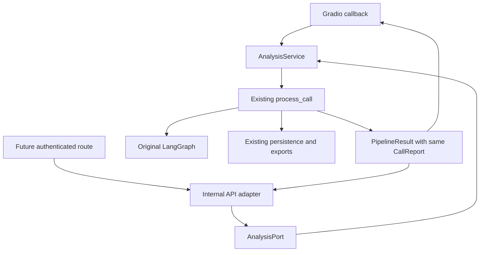

# STEP_07 — Shared analysis boundary

**STEP_08 follow-on (2026-10-25):** the local Compose app now persists through
PostgreSQL/Alembic with restricted runtime credentials and tenant scope. Original
SQLite remains a tested fallback. See [schema/ownership/recovery](../database/schema.md).
The following STEP_07 architecture record is historical; its shared service still
applies. HTTP authentication, workers and frontend replacement remain future work.

The original Gradio UI, graph, summary/QA rules, report schema and SQLite behavior
remain in use. This step introduces one injectable analysis service and a small
internal adapter for a future authenticated API. It does not implement FastAPI,
PostgreSQL migration, workers, model training or a new frontend.

## Boundaries and directory decisions

| Boundary | Current state | Responsibility |
|---|---|---|
| `src/graph/`, `src/agents/` | Preserved | Original graph, ASR, summary, QA and report contracts |
| `src/services/contracts.py` | Implemented | Immutable path request, legacy-compatible result, analysis protocol/error |
| Shared WorkflowPort/AuditPort | Implemented in contracts.py | Common resource interfaces used by the legacy pipeline and injected service; analysis.py retains their imports |
| `src/services/analysis.py` | Implemented | Injected workflow/engine/audit; delegates to the existing orchestration |
| `src/services/pipeline.py` | Preserved with compatible extension | Single analysis/persistence/export implementation |
| `src/ui/` | Existing Gradio consumer rewired | Calls shared service and renders the same six callback outputs |
| `services/api/analysis.py` | Implemented internal adapter | Returns the same typed CallReport or raises AnalysisError |
| `apps/web/` | Planned only | Approved ERP interface and shared AppShell; frontend steps |
| `services/api/` HTTP routes | Planned only | Request identity, ownership, managed uploads and typed HTTP errors in STEP_09 |
| `services/workers/` | Planned only | Durable jobs, resource separation and retries in STEP_10 |
| `ml/` | Planned only | Evaluation/training boundaries separate from inference in later steps |

Only the API package required for this adapter was created. Empty frontend,
worker and ML directories would imply no working functionality, so they are not
created now. Python packages are explicitly discovered as `src`, `src.*`,
`services`, `services.*`. Tests, scripts and generated artifacts are excluded.

## Call flow and contracts



`AnalysisRequest(audio_file, caller_id=None, department=None)` accepts a trusted
local string/Path or None. It does not grant permission to read arbitrary paths.
Gradio upload and microphone inputs are already configured as `type="filepath"`.
The old `process_call` entrypoint retains its separate numpy-tuple compatibility.

`AnalysisService(workflow, engine, audit).analyze(request)` accepts explicitly
initialized collaborators. It neither creates nor closes these resources. The
method imports and calls the legacy pipeline only when invoked. A wrong return
type raises TypeError rather than masquerading as an analysis result.

`PipelineResult` retains original fields/order/defaults and adds optional `report`
at the end. `src.services.pipeline.PipelineResult` reexports the canonical class,
so existing imports and construction remain valid. Successful service results
carry the same CallReport object that was persisted/exported. Failed results carry
no report. Existing Pydantic summary, QA and CallReport schemas are unchanged.

`services.api.analysis.analyze_call(service, request)` depends on AnalysisPort,
not on a concrete workflow or UI. It returns a successful result's report and
raises AnalysisError on failure or missing report. It is **not** an HTTP route,
server/application factory, identity verifier or public API. Future routes must
perform ownership checks and translate internal failures before calling it.

Example after the bootstrap creates workflow/engine/audit:

```python
from services.api.analysis import analyze_call
from src.services.analysis import AnalysisService
from src.services.contracts import AnalysisRequest

service = AnalysisService(workflow=workflow, engine=engine, audit=audit)
report = analyze_call(service, AnalysisRequest(managed_upload_path))
```

Analysis is invoked once; summary, QA weighting and report generation are not copied
into either adapter. `success=True` means the pipeline produced a report; a report
may retain `status="flagged_for_review"`. It is not an approval or authorization.
The original persistence-before-export and best-effort persistence behavior remain
limitations, not durable job/idempotency guarantees.

## Import safety and packaging

The new entrypoints import only standard-library contracts at runtime. CallReport
and SQLAlchemy Engine annotations use TYPE_CHECKING. No dotenv/config load,
database connection, model loading, socket or server startup occurs on import.
The existing `app.py` intentionally retains bootstrap work on import; that source
behavior is separately smoke-tested and is not described as side-effect-free.

The previous wheel omitted the `src` namespace while source code imports `src.*`.
Explicit setuptools package discovery corrects that mismatch and prevents the new
root API package from colliding with the old auto-discovered `services` name.
The wheel is verified in an isolated target outside the checkout with no runtime
dependencies; that proves lightweight entrypoint imports, not inference without
the project's declared dependencies. Editable project metadata is refreshed with
uv `--no-deps`; no dependency version change is intended.

The accidental old wheel's top-level `agents`, `graph`, etc. are not retained as
public import aliases. Repository code consistently uses the canonical `src.*`
paths; external consumers relying on accidental wheel names must use those paths.
CI lint/format now includes the new `services/` boundary and project scripts;
compile checks include both canonical source packages.

`scripts/map_project_imports.py` parses local source with AST and computes strongly
connected components using Tarjan's algorithm. Edges include nested and TYPE_CHECKING
imports, and resolve relative imports. It does not execute modules. Dynamic imports,
implicit parent initializer execution and external-package cycles are outside its
static scope; guarded runtime tests complement the map.

## Security and ownership

Resource construction remains in bootstrap code; transports receive injected
dependencies. Do not expose filesystem paths as public API inputs. STEP_09 must
map authenticated uploads/resources to managed paths, enforce per-resource scope,
and sanitize internal errors. Returning a typed report does not make incomplete
legacy PII masking or raw transcript caching safe for public exposure.

No new network boundary, auth bypass, dataset access, model training or worker is
introduced. Existing private .env and container secrets remain ignored. Docker
copies the new API package; existing Postgres/Ollama configuration is preserved.

## Shared AppShell and accessible-component migration contract

This is a design contract, not an implemented React shell. Future `apps/web` must
use one AppShell around dashboard/calls/live/model-lab routes: semantic header,
navigation landmark, main region and skip link; route selection exposed with
aria-current; visible focus and full keyboard navigation; reduced-motion support;
responsive sidebar/drawer with focus return. Base components: rounded white card,
labelled field with associated errors, green action button, semantic status pill,
accessible table, progress/status announcement and empty/error panel with recovery.

Use the approved Commercially-style reference, light neutral canvas, white rounded
cards, dark text and green accents; amber/red only for semantic warning/error.
Components must cover loading, empty, failed, review-flagged and completed states.
No simulated metrics, fake progress or unimplemented live/training state. Preserve
`flagged_for_review` as a distinct state; do not flatten it into an approved result.
Future transports must expose typed report/error/loading data without leaking
internal filenames, secrets or raw provider errors. Mobile, contrast and keyboard
acceptance require actual tests/screenshots when the frontend is built.

STEP_07 changes no visual styles or rendering structure. Original Gradio remains
the regression baseline and is not certified as approved ERP product styling.
