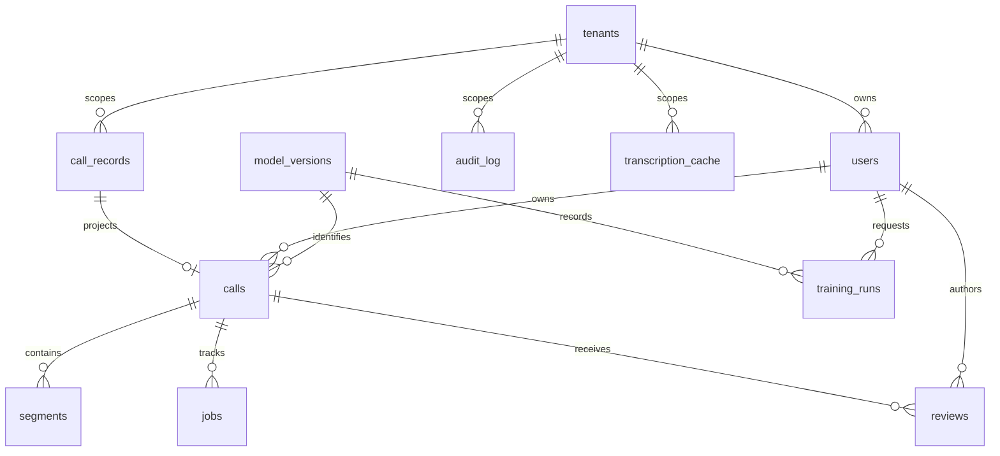

# PostgreSQL persistence and recovery

STEP_08 uses PostgreSQL17, SQLAlchemy2.0.41, psycopg3.3.6 and Alembic1.20.1.
The legacy Gradio interface and SQLite option remain supported. Native startup
uses DB_PATH unless DATABASE_URL or DATABASE_URL_FILE is configured; Compose
mounts only the restricted runtime connection file. Never configure both URL inputs.

## Schema and ownership

The reviewed initial revision is `0001_platform`. PostgreSQL startup verifies that
revision; it does not auto-create tables. SQLite keeps its original three tables
and create_all behavior. PostgreSQL metadata is in services/api/db/models.py;
its three legacy table copies add tenant_id without changing SQLite mappings.

| Table | Contents and integrity |
|---|---|
| tenants | Tenant identity; positive retention_days, default90 |
| users | Tenant identity, email/name/role, disabled-by-default account, optional password hash; no authentication service yet |
| call_records | Every original call/report field and numeric ID; PostgreSQL-only tenant column |
| audit_log | Original audit fields/IDs and tenant; runtime SELECT/INSERT only |
| transcription_cache | Original hash/payload/timestamp/ID; hash uniqueness scoped to tenant |
| calls | Normalized report identity, owner, status, optional caller/department/language/model/audio-object metadata, QA/resolution, processing/expiry/hold |
| segments | Call-linked ordered text/timing/speaker/confidence; unique position and bounded timing/confidence |
| jobs | Call-linked processing metadata and attempts; no worker is implemented here |
| reviews | Call/reviewer, unique positive review version, corrections JSONB, training approval false by default |
| model_versions | Tenant/family/version uniqueness, optional artifact URI/checksum, status and metrics JSONB |
| training_runs | Tenant-consistent model/requester links, dataset version and planned status/metrics; no training execution |
| legacy_imports | Unique tenant/snapshot checksum, completion timestamp and preserved row counts |



Composite foreign keys include tenant_id for owners, reviewers, calls and model
versions, preventing cross-tenant references. Tenant/status and tenant/time indexes
support filtered history; segment position and model/review versions are unique.
Large audio belongs in managed object storage: audio_object_key is nullable until
that integration exists. Existing report JSON remains intact, including its legacy
paths. Unknown model, language and caller/department values remain NULL; do not
invent provenance missing from old reports.

## Runtime permissions and scope

The migration owner is separate from `project28_app`. The runtime role has no
superuser/createdb/createrole/inherit/bypassrls rights, owns no application table,
cannot create public tables or modify audit history, and reads Alembic's revision
without changing it. Explicit provisioning does not silently rotate existing
passwords. Keep the original generated runtime password file with its matching role.
Tenant/user/import-ledger and model/training metadata are read-only to inference;
model promotion and training metadata writes require a separate trusted owner path.
Provisioning also rejects any existing role membership: NOINHERIT does not prevent
explicit SET ROLE. Unexpected memberships require administrator review, not an
automatic revoke or a silent privilege adjustment.

All12 data tables have ENABLE/FORCE ROW LEVEL SECURITY. Policies compare the row's
tenant to transaction-local app.tenant_id. Missing scope denies rows. The legacy
Gradio engine sets the provisioned legacy tenant on each transaction; shared
session_scope can set a trusted tenant for a transaction. Pool reuse does not retain
the override. Canonical repository queries also include explicit tenant predicates.

This is not user authentication. STEP_09 must derive tenant/owner/role from trusted
identity, never a caller-controlled header or arbitrary SQL. An application SQL
account able to issue unrestricted SQL can change its tenant setting. Migration
superusers bypass RLS by design and must never be the runtime credential. Global
legacy IDs are retained; sanitize constraint errors at future HTTP boundaries.

## Migrations and first import

Keep URLs in private files; examples name files, never credential values. The
Windows uv environment must have requirements and dev extras installed.

```powershell
$env:DATABASE_URL = ""
$env:DATABASE_URL_FILE = ".local/step08_admin_url"
uv run --no-sync python -m alembic upgrade head
$env:APP_DATABASE_PASSWORD_FILE = ".local/database_app_password"
uv run --no-sync python -m services.api.db.admin
uv run --no-sync python -m services.api.db.legacy_import backup path/to/legacy.db .local/backups/legacy-snapshot.db
uv run --no-sync python -m services.api.db.legacy_import import .local/backups/legacy-snapshot.db
```

Backup uses SQLite's online backup API and integrity_check; a WAL database must
not be migrated using a casual file copy. A backup destination must not exist.
For Docker's original SQLite file, create the online snapshot inside the container,
then transfer bytes with a checked binary subprocess. Docker cp could not see this
host's /tmp tmpfs file even though exec could read it; PowerShell text redirection
must not be used to transport database bytes. The implementation evidence records
the actual checked binary transfer and private snapshot location.

Import reads the snapshot in read-only/query-only mode and pins a SQLite read
transaction. WAL-mode input or a WAL sidecar is rejected:
first export with backup_sqlite, which normalizes only the new artifact to DELETE
journal mode. Streaming checksums identify that standalone artifact and are checked
again before target commit. Internally owned source/backup connections close on
success and failure; direct callers of readonly_sqlite must close its returned handle.
Import locks the target tenant
against concurrent imports, refuses existing tenant rows or numeric ID collisions,
preserves every original field/ID, validates embedded reports, creates normalized
calls/segments and verifies each inserted legacy field. It updates sequences and
writes an import ledger in the same target transaction. Any failure rolls back.
An exact snapshot checksum replay returns its prior result without duplicating rows.
Different archives are not implicitly merged or assigned replacement IDs.

Legacy timestamps without an offset are interpreted as UTC only for normalized
expiry/projection; original naive timestamp fields and report JSON are preserved.
Resolve historical timezone ambiguity before relying on them for operational SLAs.
The importer targets small legacy archives; large production-volume migration and
concurrent cutover are not certified by the seven-row validation sample.
Quiesce analysis submissions before the final snapshot/cutover and reconcile any
new source rows before changing the app URL. The import CLI does not coordinate
active writers. The actual local source still contained the same three reports,
three audit rows and one cache row after this cutover.

## Local app and fallback

Compose reads `.local/database_url`, containing the runtime URL with internal
hostname postgres. Host-side tools use the host URL file on127.0.0.1:5433.

```powershell
docker compose --env-file .env.docker -f compose.local.yml up -d --build --wait app
```

Reports and normalized rows commit together. Audit logging remains the original
separate transaction. The existing best-effort report-persistence exception behavior
is retained; analysis/export success alone does not establish persistence success.
The real migration smoke separately queried both stored report representations.

## Rollback and restore

Never run destructive down on populated databases. The revision explicitly refuses
that action. Empty upgrade/down/upgrade was executed in an isolated validation DB.
For populated recovery, take pg_dump -Fc before change, restore with pg_restore
into a new database, compare every field/count, then provision runtime privileges
and repoint its private URL. This step executed populated restore and full row
comparison in a separate database; it did not overwrite the live database.

The original SQLite volume and private backups are retained. For compatibility
fallback, after stopping new writes and preserving/exporting PostgreSQL-only work:

```powershell
docker compose --env-file .env.docker -f compose.local.yml -f compose.sqlite.yml up -d --no-build --wait app
```

That override clears both URL options and uses the preserved DB_PATH. It does not
copy newer PostgreSQL calls back to SQLite: reverting immediately would hide those
new calls. Switching forward again omits compose.sqlite.yml. Configuration merge
and SQLite app bootstrap were tested; a live reverse-data migration was not built.

## Retention and frontend data contract

Tenant.retention_days sets new calls' expires_at. expire_calls is an explicit dry-run
by default; apply removes eligible non-held legacy/canonical call rows and cascades
segments/jobs/reviews. Legal-hold calls remain. expire_cache explicitly purges old
ephemeral raw cache separately; both functions require timezone-aware cutoffs and
tenant scope. No destructive retention action was applied to the live sample data.
There is no automatic scheduler yet. Audit archival/object-store lifecycle and
secure backup expiry need separate operational policies; do not treat this as a
complete recording-retention deployment.

CallListItem provides truthful owner/status/score/model/expiry fields for ERP
history and filters. TenantMetrics calculates tenant-only counts and average QA
from real rows, including zero scores and NULL when no score exists. Unknown model
IDs must render as unknown; empty tables must render zero/empty states. No new UI,
training progress or broker state is simulated by these database contracts.

## Validation

Set PROJECT28_TEST_ADMIN_URL_FILE and PROJECT28_TEST_APP_URL_FILE to the private
isolated test-database files, then run pytest tests/. Without those files the real
PostgreSQL integration module skips explicitly. Local STEP_08 validation supplied
them and ran every case; current remote CI still runs its original unit/security
selection and has not been executed in this task. Strict mypy and Ruff include the
new database package; Ruff also includes migration files. See the implementation
report/evidence for exact counts, versions, measurements and remaining limitations.
